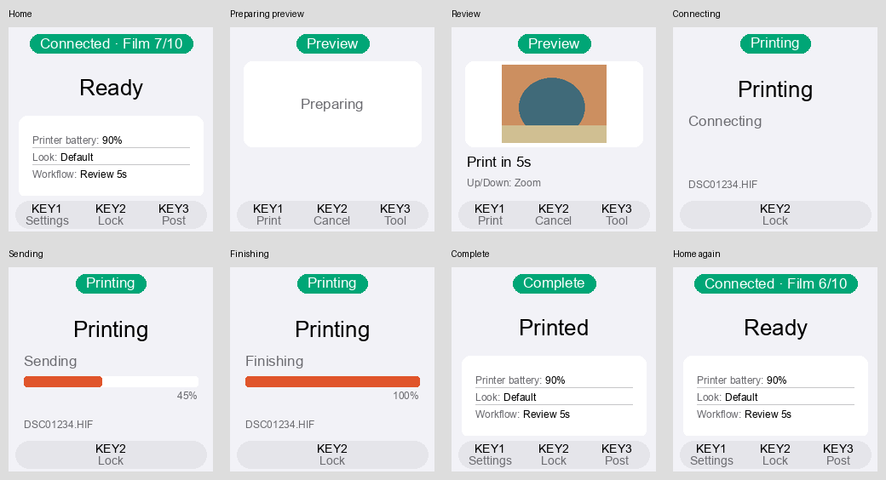

# 065 — Simplify the one-photo print flow

Date: 2026-10-11. Scope: Bridge print screens and copy; locked Wi-Fi recovery validation.

## User request

Deploy the pending Wi-Fi recovery fix and verify it while locked with the Printer connected.
Reduce the number of screens and verbose text shown when printing one photo.

## Screen audit and implementation

The old path displayed receipt, a preparation placeholder, a timer-free Preview frame, review,
Starting/Checking/Finding Printer, transport stages, standalone completion and Home. Some states
lasted only until the next coroutine completed, producing flashes without a useful decision.

| Path | New visible flow |
| --- | --- |
| Timed review | One Review card: Preparing → photo plus countdown → one Printing layout → Home with Printed notice |
| Manual review | Same Review card; editing stops the countdown and KEY1 confirms |
| Immediate printing | One Printing layout → Home with Printed notice |
| Cancel | Return to cached Home; cancel preparation safely |
| No film | Keep reload guidance and allow navigation; normal polling detects reloaded film |
| Failure | Preserve the error and Check action; never resend automatically |
| Slow/stalled job | Keep Still printing / Print stalled and restart feedback |
| Sync | Spool and Sync Home retain their existing behavior; no print screens |

- Receipt records photo identity and activity without a separate screen or timer.
- Preparation stays inside the fixed photo card. The first ready frame includes its actual
  countdown; no timer-free preview flash precedes it. Editing retains manual confirmation.
- Printing keeps a fixed headline and one short stage: Connecting, Preparing, Sending or
  Finishing. One progress bar/percentage and the filename provide useful feedback. Remove
  duplicated progress, packet/KB details, Printer model, repeated key hints and generic warnings.
- Completion uses Home's existing card with Printed feedback, including a successful last-sheet
  print. Its two-second expiry cannot replace Settings/Post opened by the user. No-film guidance
  likewise has no forced expiry that flashes a new Printer check.
- English and Chinese use the same concise wording. Print admission, transport serialization,
  no-film checks, hard timeout, active-job boosts, lock and same-button unlock remain intact.

## Rendered evidence

Synthetic local render using a neutral test image, not a physical LCD photograph. Connecting,
Sending and Finishing above are progress updates within one layout.

## Validation and device status

Clean runtime **`cbffa65`** is deployed. The normal pre-commit gates passed: **1,307 Bridge
tests**, Ruff and strict mypy (65 source files). Touched-file formatting, shell syntax,
whitespace and strict MkDocs passed. Independent review found no remaining actionable defects.
No App/iOS contract changed. The first full run found an old test expecting Print complete;
its assertion was updated for the requested Printed copy and the entire suite passed.

Controller/app/preview/renderer tests cover initial frames, countdown timing, navigation during
completion/no-film, concise stages, translated copy and last-sheet success. A locked-recovery
regression covers a dark display, idle CPU tier and preserved Printer state.

### Device discoveries

USB initially did not enumerate; reconnecting restored `en8`/SSH. During deployment the camera
logged into FTP without uploading a photo. Its past login exposed an overly conservative guard
that deferred a missing hotspot for five minutes. Recovery now defers recent activity only on
other transports; active photo preparation/printing/queues remain guarded. A failed hotspot
cannot carry an ongoing Wi-Fi upload.

The first actual missing-interface trial could not unload `brcmfmac`: its `brcmfmac_wcc` vendor
extension retained a module reference. The helper now removes that fixed Wi-Fi dependency first,
only when `wlan0` is absent. The next background retry repaired the existing fault without
restarting the Bridge or Bluetooth. The Printer stopped advertising during the extended earlier
trial; after the user turned it back on, the Bridge automatically reconnected. The accepted final
trial below establishes continuity during recovery, not indefinite Printer uptime.

### Accepted hardware smoke

Hardware: Pi Zero 2 W Rev 1.0 / Waveshare ST7789 240×240 LCD HAT / X306 2300 mAh; Debian 13,
kernel 6.12.47+rpt-rpi-v8, Python 3.13.5, BlueZ 5.82, Bridge 0.1.17. Printer: Instax Square
`INSTAX-52006924`, film 4. Camera profile remains Sony a7C II; no new photo upload was exercised.

A temporary observation wrapper ran the **real Bridge application**, injected its normal KEY2
abstract action after Printer readiness and recorded controller state. Physical GPIO input,
framebuffer/backlight, CPU helper, NetworkManager and Rust FFI BLE were real. It used no test
doubles. Faults were injected over USB SSH, leaving the runtime's own recovery responsible for
restoring Wi-Fi.

| Fault | Restore time | Samples | Outcome |
| --- | --- | --- | --- |
| Saved hotspot profile deactivated | 32.90 s | 60 | Expected IP and FTP readiness restored |
| SDIO function 1 unbound, `wlan0` absent with driver loaded | 31.99 s | 59 | Driver and hotspot restored automatically |

Each trial observed another 31 seconds after restoration. Every sampled CPU frequency was
600 MHz with powersave; GPIO24 remained low and the controller stayed locked. BlueZ reported
Connected at every sample, and fresh Printer status continued advancing at its 10-second cadence.
The final driver trial additionally monitored selected-device D-Bus property changes and saw
no connection-loss event. The Bridge PID was unchanged during both accepted trials; film stayed
at 4. USB SSH remained usable. The temporary wrapper/drop-in and probe files were removed and
the normal service restored afterward.

[Recorded observations](../assets/bridge-print-065/wifi-recovery.json) include the controller,
CPU, backlight, interface and BlueZ measurements. The profile trial used controller `46f155f`;
the final driver trial included helper `cbffa65`. An initial SDIO function-2 test did not remove
`wlan0` and was rejected by the fault assertion; the accepted trial used function 1.

Normal service was restored at 21:43 EDT with Bridge, manager, Bluetooth and NetworkManager
active, NRestarts=0, Printer connected (film 4/battery 65%), throttling 0x0 and hotspot FTP
greeting/NOOP passing. Debian 13.2 and BlueZ 5.82 were rechecked.

No film was consumed. Physical switch actuation, colour output on film, a new camera upload and
a 16-hour full-charge discharge remain outside this smoke's acceptance.
